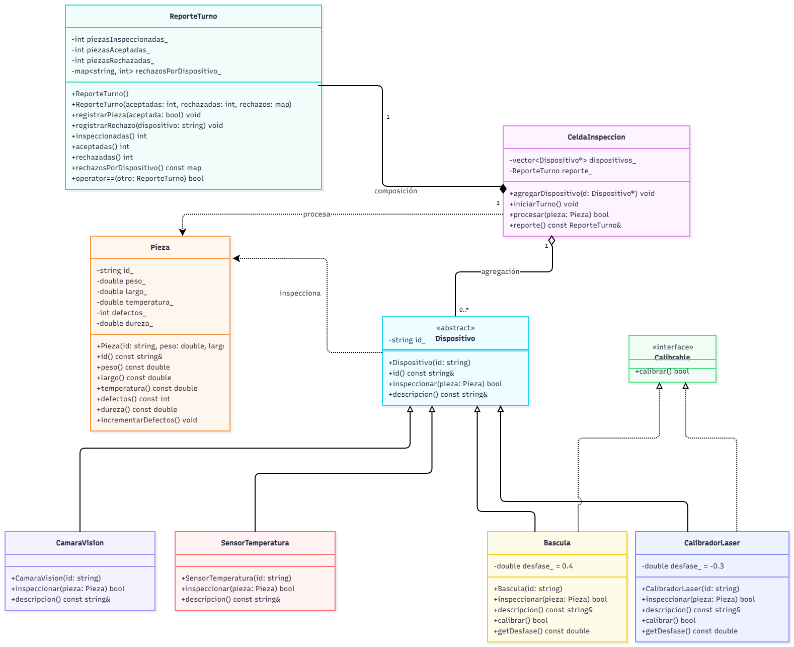

# Celda Robótica de Inspección de Calidad

Proyecto del Parcial 3 de Programación Orientada a Objetos.

La guía completa del proyecto está en [PROYECTO.md](PROYECTO.md). Léanla antes de empezar.

## 1. Equipo

| Integrante | Matrícula | Nombre | Usuario de GitHub | Clase |
| --- | --- | --- | --- | --- |
| 1 | 24090| Luis Samano Saavedra| LuisSaSa4 | SensorTemperatura|
| 2 | 22038 | Jesus Rene Pamanes Ferreira | TacocraftG | Bascula |
| 3 | 25292 | Yurik David Alrcon Gutierrez | Kothy-Web|CamaraVision|
| 4 |25238 |Daniel Gerardo Guerra Rodriguez | mohawkcat |CalibradorLaser |
| 5 |25436 |Fernando Caleb Roman Zamarripa|FernandoRoman1709 |ReporteTurno|
| 6 (solo equipo de seis) | | | | |

## 2. Cómo compilar y ejecutar

Escriban el comando exacto que usa el equipo para compilar y el comando para ejecutar.

g++ -Wall -Wextra -std=c++17 -Iinclude src/*.cpp -o celda
.\celda

## 3. Contrato de `Dispositivo` y `Calibrable`

**¿Qué errores dio el compilador al compilar el repositorio base y qué significaba cada uno?**

src/CeldaInspeccion.cpp: In member function 'void calidad::CeldaInspeccion::iniciarTurno()':
src/CeldaInspeccion.cpp:13:29: error: cannot 'dynamic_cast' 'd' (of type 'class calidad::Dispositivo*') to type 'class calidad::Calibrable*' (source type is not polymorphic)
   13 |         if (Calibrable* c = dynamic_cast<Calibrable*>(d)) 
      |                             ^~~~~~~~~~~~~~~~~~~~~~~~~~~~
src/CeldaInspeccion.cpp:14:65: error: 'class calidad::Dispositivo' has no member named 'descripcion'
   14 |             std::cout << "Calibrando " << d->id() << " (" << d->descripcion() << ") ... "
      |                                                                 ^~~~~~~~~~~
src/CeldaInspeccion.cpp:15:30: error: 'class calidad::Calibrable' has no member named 'calibrar'; did you mean 'Calibrable'?
   15 |                       << (c->calibrar() ? "OK" : "FALLA") << '\n';
      |                              ^~~~~~~~
      |                              Calibrable                                                                        >                                                          al_3_celda_inspeccion> 

**Error 1: source type is not polymorphic**
 
El programa intenta convertir un puntero de tipo Dispositivo* a Calibrable* utilizando dynamic_cast. El problema es que Dispositivo todavía no era una clase polimórfica, porque no tenía ningún método virtual declarado. Para que dynamic_cast pueda realizar esta conversión, la clase de origen debe ser polimórfica, es decir, debe contar con al menos una función virtual.
 

**Error 2. Dispositivo has no member named descripcion**
 
La celda intenta obtener la descripción del dispositivo para imprimir qué aparato está calibrando.
Sin embargo, la clase Dispositivo todavía no tiene declarado un método llamado descripcion().
 

**Error 3. Calibrable has no member named calibrar**
 
La celda intenta ejecutar el método calibrar() para ajustar los dispositivos que tienen esa capacidad.
Sin embargo, la clase Calibrable todavía no declara dicho método.
 
 

**¿Qué métodos agregaron a `Dispositivo`? ¿Cuáles son virtuales puros, cuáles son `const` y por qué el destructor es virtual?**

Agregamos dos métodos virtuales puros: inspeccionar(const Pieza& pieza) const y descripcion() const. El primero permite que cualquier dispositivo pueda inspeccionar una pieza y devolver un resultado verdadero o falso. El segundo permite obtener una descripción del tipo de dispositivo.

Ambos métodos son virtuales puros porque cada dispositivo debe proporcionar su propia implementación y no tendría sentido crear un dispositivo genérico sin esas funciones.

Los dos métodos utilizan const porque no necesitan modificar el estado del dispositivo para realizar sus operaciones.

También agregamos un destructor virtual (virtual ~Dispositivo() = default;) para asegurar que, cuando se destruya un objeto derivado mediante un puntero Dispositivo*, se ejecute correctamente el destructor de su clase correspondiente.

**¿Qué agregaron a `Calibrable` y por qué no tiene atributos?**

Agregamos el método virtual puro calibrar(), que devuelve un valor booleano para indicar si la calibración se realizó correctamente. También agregamos un destructor virtual para permitir destruir de forma segura los objetos que implementen esta interfaz mediante un puntero Calibrable*.

No agregamos atributos porque Calibrable representa una capacidad y no un dispositivo en particular. Su función es establecer qué método deben implementar los dispositivos que pueden calibrarse, mientras que cada clase concreta se encarga de manejar sus propios datos y características.

## 4. Cálculo a mano del reporte

Turno de 12 piezas, con la celda ya calibrada. Escriban `ACEPTA` o `RECHAZA` por dispositivo. La columna D-01 solo la llena el equipo de seis.

| Pieza | B-01 | L-01 | V-01 | T-01 | D-01 | Resultado |
| --- | --- | --- | --- | --- | --- | --- |
| P-01 | 12 | 50 | 25 | 0 | * | ACEPTA |
| P-02 | 15 | 50 | 24 | 0 | * | ACEPTA |
| P-03 | 16.2 | 50.1 | 25 | 0 | * | RECHAZA |
| P-04 | 12.5 | 50.5 | 26 | 0 | * | ACEPTA |
| P-05 | 11 | 50.7 | 25 | 0 | * | RECHAZA |
| P-06 | 13 | 50.2 | 23 | 2 | * | RECHAZA |
| P-07 | 12.2 | 49.9| 41 | 0 | * | RECHAZA |
| P-08 | 9.5 | 51 | 25 | 1 | * | RECHAZA |
| P-09 | 14.8 | 50 | 35 | 0 | * | ACEPTA |
| P-10 | 10.5 | 49.6 | 22 | 0 | * | ACEPTA |
| P-11 | 13.5 | 50.3 | 19.5 | 0 | * | RECHAZA |
| P-12 | 12.8 | 49.9 | 27 | 0 | * | ACEPTA |

**Reporte esperado (inspeccionadas, aceptadas, rechazadas y rechazos por dispositivo):**

| Concepto | Equipo de 5 |
| --- | --- |
| Inspeccionadas | 12 |
| Aceptadas | 6 | 
| Rechazadas | 6 | 
| Rechazos B-01 (Bascula) | 2 | 
| Rechazos L-01 (Calibrador Laser)| 2 | 
| Rechazos T-01 (Sensor de temperatura)| 2 | 
| Rechazos V-01 (Camara de vision)| 2 |
| Total de rechazos registrados| 8 |

**¿Coincide con lo que imprime el programa? Si no coincidió al primer intento, ¿qué encontraron y cómo lo corrigieron?**

El resultado fue lo esperado al trabajar cada clase de manera consiente y  manejando  un obketivo el cual era replicar los resultados hechos a mano , generando un codigo limpio y  el cual fue siguiendo los parametros de la  programacion orientada a objetos

## 5. Diagrama de clases

Diagrama de clases de la solución completa, hecho en draw.io. Guarden la imagen en la raíz del repositorio como `diseno_solucion.png`.

## 6. Documentación individual

| Integrante | Documentación de su clase | Rama del reto opcional |
| --- | --- | --- |
| | `docs/<matrícula>/<Clase>.md` | `<matrícula>` o "No" |
|1 |`docs/<24090>/<SensorTemperatura>.md`| |
| | | |
| | | |
| | | |
|5 | | |

Los resultados de los experimentos están en [docs/experimentos.md](docs/experimentos.md).

## 7. Prueba de extensibilidad

Practiquen agregar un dispositivo nuevo antes de entregar.

**¿Qué archivos tuvieron que crear o modificar? ¿Tuvieron que tocar `CeldaInspeccion`?**

[Inserta aquí tu respuesta]

## 8. Reflexión del equipo

**¿Qué aprendieron en este proyecto?**

[Inserta aquí tu respuesta]

**¿Qué cambiarían de su proceso de trabajo como equipo?**

[Inserta aquí tu respuesta]
